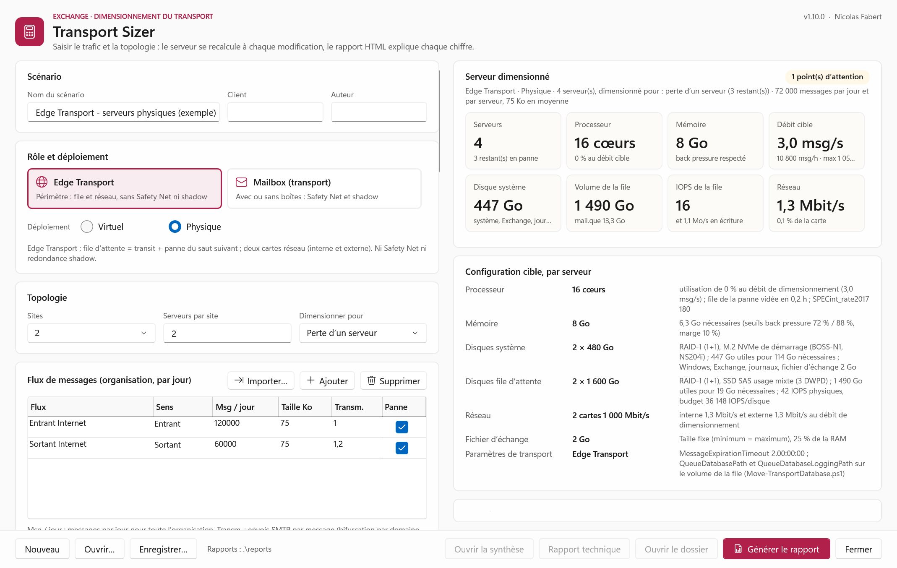

# Transport Sizer

Sizing of Exchange Server transport servers without Excel: **Edge Transport**, and **Mailbox servers for their transport part** (relay servers with or without mailboxes). A WPF window replaces the input sheet of the calculator, the server is recalculated at every change, and a self-contained HTML report explains every number: formula, computation with the actual values, and origin.



The user interface and the report are in French. The method, step by step with the lab measurements, is described in French in [docs/Methode-de-dimensionnement.md](docs/Methode-de-dimensionnement.md).

## Why

The Exchange Server Role Requirements Calculator (10.7) sizes transport only as the size of the transport database: messages per day per server × 2 (shadow) × (1 + 0.5 × expiration days + Safety Net days) × average size. It has no CPU, memory, IOPS or network for transport, and it applies shadow redundancy and Safety Net to every transport server. Transport Sizer:

- separates **Edge Transport** (no Safety Net, no shadow redundancy) from **Mailbox** (Safety Net and shadow copies, even without any mailbox on the server);
- models the queue from its causes: messages in transit (Little's law), backlog of an outage of the next hop (worst window of the working day, capped at the message expiration), Safety Net, shadow copies;
- takes **CPU, memory and IOPS only from measurements**: by default the **reference profiles** measured in the lab and shipped with the tool (generic sizing, even for a project without any Exchange server to measure); a profile measured on a server of the customer replaces them, and three adjustments (processor, I/O, memory at rest) adapt either of them to the context. No generic constant is turned into a result; the Microsoft recommended memory (64 GB Edge, 128 GB Mailbox) is shown for information only;
- applies the back pressure thresholds of Exchange to volumes and memory, sizes physical disks from the **manufacturer catalogue shared with Mailbox Sizer**, with separate system/queue disks, RAID write penalty and rebuild overhead, and keeps the calculator result as a comparison.

## Requirements

- Windows PowerShell 5.1 (Windows Server, nothing to install) or PowerShell 7.
- With PowerShell 7.5 or later (.NET 9+), the window uses the Fluent theme of Windows 11, light or dark like Windows. Otherwise it uses the classic controls with the same colours.

## Use

```powershell
# Window
.\Invoke-TransportSizer.ps1

# Window with a scenario
.\Invoke-TransportSizer.ps1 -Scenario .\examples\Edge-Internet.json -Gui

# Command line: summary in the console, HTML report in .\reports
.\Invoke-TransportSizer.ps1 -Scenario .\examples\Mailbox-Relay.json -Open

# Another calibration profile than the one of the scenario
.\Invoke-TransportSizer.ps1 -Scenario .\examples\Edge-Internet.json -Calibration .\Calibration-EDGE01.json -Open
```

In the window: choose the role and the deployment, describe the topology (sites, servers per site, failure to absorb), the message flows (messages per day for the whole organisation, size, SMTP transmissions per message, held or not during an outage), the load (growth, burst, rules, TLS, messages per session), the working day (working hours, share of the traffic outside them, length of the peak, peak as a share of the day or as a rate measured in messages per hour or per second), the resilience settings, the storage and the network, and the profile. Without a profile of its own, the scenario uses the reference profile of its role (*Profil de référence*: REF-EDGE for an Edge, REF-MAILBOX for a Mailbox server). *Importer un profil…* replaces it with the profile of a customer server; *Ajustements du profil* adapt either of them. *Enregistrer* saves the scenario (JSON, calibration embedded); *Générer le rapport* writes and opens the report.

As a module:

```powershell
Import-Module .\TransportSizer.psd1
$scenario = Import-TsScenario .\examples\Edge-Internet.json
$result = Invoke-TsSizing -Scenario $scenario   # calibration of the scenario, or -Calibration (Import-TsCalibration <profile>)
$result.Summary
Export-TsReport -Result $result -Open
```

## Traffic measured by Exchange Log Report

The flows can come from the logs of the existing servers instead of estimates. [Exchange Log Report](https://github.com/Nico77600/ExchangeLogReport) reads the message tracking and SMTP protocol logs; its **detailed** report writes one row per message (`<prefix>-Messages.csv`) and one row per SMTP transaction (`<prefix>-SmtpSessions.csv`). Take at least seven days, on the servers to replace (all the Edge servers, or all the Mailbox servers of the relay):

```powershell
# Exchange Log Report, on the server that collects the logs (no new collection)
.\Invoke-ExchangeLogReport.ps1 -Range Last7Days -ReportType Detailed -NoCollect

# Transport Sizer: the latest detailed report of a folder of reports, sized and saved as a scenario
.\Invoke-TransportSizer.ps1 -LogReport D:\ExchangeLogReport\reports -SaveScenario .\Measured.json
```

In the window, *Importer…* above the flows reads a `<prefix>-Messages.csv` file: the flows are replaced, the other values are kept. As a module: `Import-TsLogReport`, `Update-TsScenarioFromLogReport`, `Format-TsLogReportSummary`.

| Value | From |
|---|---|
| Direction of a message | Directionality of message tracking: *Incoming* → inbound. *Originating* → outbound when at least one recipient was sent by SMTP (status *Sent*: relayed outside the transport services), internal otherwise. On an Edge, every *Originating* message is outbound. |
| Messages per day | Messages of the period ÷ hours covered × 24 (`-LogReportDay Average`, nights and weekends included), or the busiest complete day (`Busiest`). |
| Average size | Mean of *Size (KB)* per direction. |
| Transmissions | Outbound: recipient domains sent per message (one SMTP transmission per domain). Inbound and internal: 1. A Mailbox server behind an Edge or a smart host sends one copy per message: set 1 when needed. |
| Peak | Messages of the busiest hour of the period: measured peak rate (msg/h) and share of the day. |
| Working day | Over at least a day: working hours = hours of the day above the hourly average, share of the traffic outside them, length of the peak = hours at 80 % or more of the busiest hour of the day. |
| Messages per session, TLS | Receive sessions of the transport service (*Edge* role, else *Hub*, else *FrontEnd*): messages accepted per session that carried a message, share of sessions with TLS. |
| Not counted | Mail refused or deferred during the SMTP session (never queued) and journal reports (sender `MicrosoftExchange329e71ec88ae4615bbc36ab6ce41109e`): turn journaling on in the scenario, it computes them. |

The CSV files are read once by a small C# reader compiled on first use (`src\Sizer.LogReader.cs`): 300 000 messages in 3 seconds with Windows PowerShell 5.1 or PowerShell 7. A *Usage* report has no list of messages and is refused with the command to run. The import warns about a period shorter than a week, messages without directionality and journal reports.

## Report

Two HTML reports from the same sizing, side by side in one folder, `reports\TransportSizer_<scenario>_<date>`: a technical report for the person who sizes, and a visual summary for the customer.

| File | Content |
|---|---|
| `TransportSizer-Synthese.html` | Customer summary, visual and short: the design in one sentence and four figures (servers, each server, expected peak, capacity with the servers left), the architecture (sites, servers, servers lost in the failure scenario, daily flows), the configuration of each server (processor and host, memory and reservation, system and queue disks with IOPS or RAID, network cards, Windows Server and Exchange SE) with the totals of the farm, the processing capacity per second, hour and day against the peak, a typical day hour by hour against the capacity, the network load per card with the Internet link of the farm and the drain after an outage, the incident in four steps (servers lost, outage of the next hop, messages kept, return to normal), the assumptions and the points of attention in plain words. Self-contained (no external resource, no network call, no storage): it opens offline, prints on A4 and renders in the OneDrive preview |
| `TransportSizer.html` | Technical report: target configuration per server, composition of the queue and of the system volume, flows, every value with formula, computation and origin (input, computed, Microsoft, lab measurement, assumption, calibration, rule), checks, calibration, scenario |
| `TransportSizer-Result.json` | The whole result |
| `TransportSizer-Scenario.json` | The scenario with its calibration: reopening it gives the same report |

## Model

| | Edge Transport | Mailbox (transport) |
|---|---|---|
| Queue | transit + outage backlog | transit + outage backlog + Safety Net, and the same again for the shadow copies held for the other servers when at least two servers are left |
| Safety Net, shadow | not counted (role Mailbox only) | `max(SafetyNetHoldTime, ReplayLagTime)`; shadow counted when the boundary keeps two servers after the failure: the AD site without a DAG (the shadow copy stays in the site), the DAG otherwise. Warning when a server can be left alone in its site |
| Network | two cards: external (Internet) and internal | one card, shadow copies included |
| CPU, memory, IOPS | calibration | calibration |

Main rules, all shown in the report:

- traffic per server = organisation traffic × (1 + growth) ÷ servers left after the failure; peak share = measured peak rate (msg/h of the organisation) ÷ messages per day, or the share entered; design rate = traffic per server × peak share ÷ 3 600 × burst factor. Hourly profile of the day: the peak hours at the peak share, the other working hours share what is left of the working day, the hours outside it share the traffic outside working hours. The peak hours cannot carry more than the working day (error), a peak below the average of the working hours is raised to it (warning);
- journaling (Mailbox role): the Journaling agent of the Mailbox servers writes one journal report per journaled message and journal destination, with the original message attached unaltered and a summary of its envelope (envelope journaling, the only method of Exchange). The engine adds a computed flow *Rapports de journal*: messages of the flows in the scope (internal, external or all messages) × journaled share × destinations, size of the message + envelope (4 KB by default), outbound towards an external archive or internal towards a journaling mailbox, held when the destination is unreachable (reports are retried until `MessageExpirationTimeout`). The reports then go through the queue, Safety Net, the shadow copies, the network and the outage like any other message: journaling all the messages roughly doubles the traffic of the Mailbox transport. On an Edge, journaling is not applied: the reports to an external archive routed through the Edge are entered as an outbound flow;
- outage backlog = full days + the shares of the busiest hours of the hourly profile for the remaining hours, of the traffic of the held flows;
- `mail.que` = empty database (0.5 GB measured in the lab) + messages queued at the worst moment × ESE factor (calibrated: growth of `mail.que` during a backlog step, or on a Mailbox profile its growth per MB stored, since Safety Net keeps every message) + messages delivered since the last reclamation of their space (traffic of `SpaceReclaimDays` days, 1 by default, × measured growth per MB, shadow copies included); transaction logs = 3 × DatabaseCheckPointDepthMax (back pressure reserve);
- volume size = content ÷ min(design fill, back pressure threshold: 96 % mail.que, 89 % logs and TransportRoles\data);
- CPU: logical processors busy on the reference at the design rate × target units per logical processor of the reference × hypervisor overhead × processor adjustment ÷ maximum utilisation (80 %). Units per logical processor = capacity of a logical processor of the reference ÷ capacity of a unit of the target, both in SPEC CPU2017 integer rate per core: a logical processor of the reference is a hyper-thread (SPECint per core × cores ÷ logical processors; an Azure vCPU is half a core of Xeon Platinum 8573C, 8.5 estimated from the Platinum 8580), a vCPU of a VM without SMT (÷ 1 + SMT gain) or a core; a vCPU of the target gets SPECint per core of the host ÷ max(vCPU per physical core, 1 + SMT gain): 83 % of a core at 1:1 (one thread), half at 2:1 (default, the most Microsoft supports), a third at 3:1 (warning); a core of a physical target counts whole. SMT gain 20 %: median of five systems measured by SPEC with and without SMT. `data\Processors.csv` lists 69 Xeon and EPYC processors with the median SPECint per core of their published results; the CPU of the reference = idle + cost per message × messages/s + cost of the size × MB/s + cost of a rule × messages/s × rules + cost of a session × sessions/s + cost of a TLS negotiation × TLS sessions/s + cost of a journal report × reports/s (Mailbox), each term from the calibration when its steps measured it. With a journal term, the journal reports leave the messages received over SMTP (rate, MB/s, sessions) and count as reports;
- processors proposed = max(minimum, 4 by default; cores for the peak; cores for the drain target), rounded up to an even number of vCPU in virtual (`EvenVcpu`, on by default: sockets × cores, vNUMA, hyper-threading pairs; Microsoft recommends one vCPU per physical core, two at most) and to an even number of cores for a physical server whose cores are not entered;
- drain: once the next hop is back, the queue of the outage is sent again while the traffic of the working hours keeps arriving. Drain rate = (capacity of the proposed processors at the maximum utilisation − CPU at the working-hours average) ÷ CPU of a message sent from the queue (measured during a drain: 0.11 % per message/s on REF-EDGE, about ten times less than a received message of 75 KB; deduced by analogy on the Mailbox reference; a received message when the profile has no drain), capped by the network and by the drain rate the profile measured (beyond it, the next hop sets the pace). Cores for the drain target (`DrainTargetHours`, 12 h by default, 0 = none) = (CPU at the working-hours average + CPU of a sent message × backlog ÷ target) on the reference, scaled like the peak;
- memory reservation (virtual): memory to reserve at least = RAM needed at the worst moment without the margin; RAM needed without an outage = the same with the messages in transit only. `MemoryReservedPercent` (100 % by default: Microsoft does not support dynamic memory nor memory overcommit for Exchange) is checked against both;
- memory: max(EdgeTransport private bytes ÷ 72 %, used memory ÷ 88 %) × (1 + margin), queued messages included, the memory at rest of the customer replacing that of the profile when it is entered (memory per queued message = fixed part + part per KB of message when backlog steps at two sizes measured it); pagefile 25 % of the RAM. Messages in transit are counted whole; the messages of the outage are counted dehydrated when the profile measured it: under memory pressure (SystemMemory 88 % or PrivateBytes 72 %, medium level) Exchange drops their content from memory and reads it again from `mail.que`, so the RAM must hold the dehydrated queue, not the whole one. The report gives how many messages the proposed RAM keeps whole before the first dehydration, and warns when EdgeTransport reaches 72 % first (messages of non-Exchange servers refused with 4xx while it dehydrates);
- queue volume: IOPS and write throughput (MB/s, from the bytes written during the steps) × (1 + I/O overhead) × I/O adjustment, both capped on cloud disks;
- physical disks: max(disks for capacity, disks for (reads + writes × RAID penalty) × (1 + I/O overhead) ÷ (1 − rebuild overhead)). `data\Disks.csv` contains the Mailbox Sizer manufacturer models and generic classes with their reference model, original specifications, conditions, source URL and check date. No old calculator disk IOPS are used.

### Physical disk selection

The queue defaults to mixed-use SAS SSDs (3 DWPD); the system defaults to a hardware-mirrored M.2 boot pair. Select their models and capacities independently. `Physical.DiskSizeGB` and `SystemDiskSizeGB`: **0 = automatic** (fewest disks meeting capacity and IOPS, smallest capacity among ties); an explicit capacity stays unchanged, with a warning if absent from the server catalogue. Server capacities start at 8 TB for nearline HDDs and 900 GB for SSD/NVMe; boot M.2 and 10K HDD capacities are not filtered that way.

`DiskIops` and `SystemDiskIops`: **0 = catalogue**, positive = measured IOPS per disk for the actual transport workload. HDD budgets use short-queue mixed read/write figures (WD HC580: 220 IOPS at 4 KB, not the calculator's 100); models without their own mixed figure explicitly use the class reference where available. Generic classes use the slowest eligible model's transfer bandwidth **at each candidate capacity**, before choosing the RAID layout: an 8 TB disk does not inherit the HC580 22 TB bandwidth. A 10K model without manufacturer IOPS stays unknown: capacity-only sizing is marked incomplete until a measurement is entered.

Transport reads/writes come from the existing calibration, unchanged. Their **transfer size is derived from bytes/s ÷ operations/s**, weighted by the RAID write penalty, or overridden with `Physical.IoSizeKB`. This is not the message size and not automatically the 32 KB mailbox database page. HDD IOPS are corrected for the extra transfer time; SSD IOPS are capped by the manufacturer's write bandwidth divided by the transfer size. These are design estimates, not guarantees at Exchange latency: confirm the exact capacity, controller, cache, mixed workload and endurance. A profile without byte models keeps only a provisional 4 KB reference budget and a visible warning unless a measured transfer size or per-disk IOPS is supplied.

Protected RAID only; RAID-1 grows into RAID-1/0 when needed. RAID-5 wider than seven disks and low-endurance SSDs carrying the queue are flagged. When the queue is on the system, only the system disk selection applies; the queue selectors are disabled. Old scenario disk labels and `SsdIops` still import, mapped to the new catalogue; old physical results intentionally change because the old disk table is removed.

## Calibration

CPU, memory and IOPS come from a calibration profile: linear models measured on a reference server. Three cases:

| Context of the project | Profile | Result |
|---|---|---|
| No Exchange server to measure (new organisation, migration from another messaging system) | **Reference profile** of the role, shipped with the tool: REF-EDGE for an Edge (`data\Reference-Edge.json`), REF-MAILBOX for a Mailbox server (`data\Reference-Mailbox.json`) | Generic sizing, based on the lab measurements; the report says so |
| The context is known but cannot be measured | Reference profile **adjusted**: processor (%) for slower or faster processors or more agents, I/O (%) for the storage, memory at rest (GB) of a server of the customer. The SPECint_rate2017 per core of the target also scales the processor when both values are known | Generic sizing adapted to the customer; every adjustment appears in the report |
| An Exchange server of the customer can be measured | **Profile measured** on it with the scripts below, imported in the window (*Importer un profil…*) or given with `-Calibration`; the adjustments still apply | Sizing on the customer's own measurements |

The reference profiles were measured on Azure VMs (D2s_v5 Edge with the antispam agents, D4s_v5 Mailbox member of a DAG with a mounted database, Malware Agent on). The memory of the mailbox databases of the lab (four Store worker processes, ESE cache included: 0.9 GB, measured) is left out of the Mailbox reference, which keeps 12.2 GB at rest (system, IIS, indexing, Exchange services, Malware Agent); enter the memory at rest of a customer server in *Mémoire au repos* when it is known. The lessons of these runs are below.

To measure a server, ideally the same hardware or VM size as the target, with the same agents (antispam, antivirus, transport rules):

1. On the reference server (Edge Transport or Mailbox), copy `calibration\Measure-TransportLoad.ps1`. On another computer, copy `calibration\Send-TransportTestLoad.ps1`.
2. Receive connectors limit the messages per minute of one sending host (`MessageRateLimit`, source `IPAddress`). On an Edge Transport server, the default connector accepts 600 messages per minute, that is 10 messages/s. Above that, Exchange answers 4.4.2 and the step stays near 10 messages/s (the generator counts these replies as *Throttled*). For steps above 10 messages/s, use a dedicated receive connector limited to the address of the load computer, or raise the limit for the duration of the calibration (`Set-ReceiveConnector -MessageRateLimit Unlimited`), then restore it.
3. Optional: a transport rule after the measured server that deletes the messages with the header `X-TransportSizer-Calibration`, so that no mailbox grows.
4. Idle step, no load:
   ```powershell
   .\Measure-TransportLoad.ps1 -Label idle -Kind Idle -DurationSeconds 300
   ```
5. Load steps, at least three rates, the highest close to the design rate. For each rate, start the collector on the server and the load on the other computer with the same duration:
   ```powershell
   # Exchange server
   .\Measure-TransportLoad.ps1 -Label load-10 -Kind Load -DurationSeconds 660 -MessageSizeKB 75
   # Other computer
   .\Send-TransportTestLoad.ps1 -SmtpServer ref-edge.contoso.com -From calib@contoso.com -To calib@contoso.com -Rates 10 -StepSeconds 660 -MessageSizeKB 75
   ```
6. Optional backlog step (ESE factor and memory per queued message): make the next hop unreachable (`Suspend-Queue` once the queue exists, or a temporary outbound firewall rule on TCP 25 towards the Mailbox servers), start the collector, then send a known number of messages, enough to make `mail.que` grow (for example 15 000). A backlog long enough to bring the used memory to 88 % (REF-EDGE, 8 GB: about 70 000 messages of 75 KB) also measures the memory of a dehydrated message: the analysis finds the drop of the EdgeTransport memory while the queue keeps growing (on the REF-EDGE test data it gives 66 KB per whole message and 24 KB per dehydrated one; the 22 KB of the reference also leave out the growth of the ESE cache of `mail.que`, at most 512 MB, already in the memory of the load model). Remove the block afterwards and measure the drain with a `Drain` step started at the same time (CPU of a message sent from the queue):
   ```powershell
   # Exchange server, first
   .\Measure-TransportLoad.ps1 -Label backlog -Kind Backlog -DurationSeconds 1000 -BacklogMessages 15000 -MessageSizeKB 75
   # Other computer
   .\Send-TransportTestLoad.ps1 -SmtpServer ref-edge.contoso.com -From calib@contoso.com -To calib@contoso.com -Rates 20 -Count 15000 -Connections 10 -Label backlog
   # Exchange server, when the block is removed (Resume-Queue / Retry-Queue)
   .\Measure-TransportLoad.ps1 -Label drain -Kind Drain -DurationSeconds 600 -MessageSizeKB 75
   ```
7. Optional factor steps, so that the cost of what differs between the reference and the target is measured apart instead of hidden in the cost per message:
   - **size**: steps at several sizes, with attachments (`-AttachmentKB`, file size before base64; a mix with `-AttachmentWeight`), each at two rates, for example 10 KB, 500 KB and 2 MB;
   - **transport rules**: the same rate with 25 then 100 rules (Edge rules on an Edge, `New-TransportRule` on the Edge; organisation rules on a Mailbox server), the collector told with `-TransportRules`;
   - **sessions and TLS**: one message per session in plain SMTP, then in TLS (`-MessagesPerSession 1`, `-StartTls`), and TLS with long sessions;
   - **validation**: a mix of sizes, kept out of the fit with `-Validate`: the report shows what the models predict for it next to the measure;
   - **journaling** (Mailbox): the same rates with a journal rule on all messages to an external recipient (`New-JournalRule`, then `Enable-JournalRule` between the steps); the collector reads `Journal Reports Created/sec` and the analysis gives the cost of a journal report apart from the cost of a message;
   - **backlog at another size** (for example 2 500 messages of 1 MB) on a new `mail.que` (transport stopped, queue folder renamed, transport started): ESE factor and memory per queued message against the size.
   ```powershell
   .\Send-TransportTestLoad.ps1 -SmtpServer ref-edge.contoso.com -From calib@contoso.com -To calib@contoso.com -Rates 8 -StepSeconds 480 -Connections 40 -MessageSizeKB 10 -AttachmentKB 1490 -Label s2m-08
   .\Send-TransportTestLoad.ps1 -SmtpServer ref-edge.contoso.com -From calib@contoso.com -To calib@contoso.com -Rates 10 -StepSeconds 480 -Connections 60 -MessagesPerSession 1 -StartTls -Label tls1-10
   .\Measure-TransportLoad.ps1 -Label rules100-10 -Kind Load -DurationSeconds 450 -TransportRules 100
   ```
8. Build the profile, then import it in the window (*Importer un profil*) or pass it with `-Calibration`:
   ```powershell
   .\Measure-TransportLoad.ps1 -Analyze -OutputPath C:\TransportSizerCalibration -Name 'REF-EDGE lab' -SpecIntRatePerCore 9.5 -Validate mix-10
   ```

The profile keeps the average of every step after its warm-up and the models (least squares, value = intercept + Σ coefficient × load factor) with their R². Load factors of a step come from the counters of the server: messages received/s, bytes of messages received/s (size), sessions and TLS negotiations created/s, and the number of rules given to the collector. A factor enters a model only when the steps made it vary independently of the others, and no coefficient is negative: a profile measured at one size keeps one cost per message, as before. The report warns when a model is not linear (R² < 0.8), when the design rate is beyond 1.5 times the highest measured rate, when the size or the rules of the scenario are outside the measured range, and when the profile comes from another role.

Lessons from the lab run (`examples\Calibration-Reference-Edge.json`):

- Each SMTP session waits for the acknowledgement of every message: about 1.5 s on an Edge with the antispam agents and the relay to the Mailbox servers. Ten sessions stay near 6.7 messages/s whatever the rate asked: use many sessions (`-Connections`; about 50 sessions gave 16 messages/s and 110 gave 40 messages/s).
- The Edge ends an SMTP session after 5 minutes (`ConnectionTimeout`, reply 421 4.4.1): the generator reconnects and counts it apart (`Reconnects`), it is not a failure.
- Azure accelerated networking shows each card twice (synthetic adapter and virtual function): the collector keeps one of them.
- Backlog: 15 000 messages of 75 KB raised the Transport process memory by 63.5 KB per queued message (slope during the injection, R² 0.98), while mail.que grew by only 512 MB because ESE first reuses its free space. mail.que then grew from 1.3 to 3.8 GB during the drain and the load at 40 messages/s with fewer than 500 queued messages, and never shrinks. The ESE factor needs a longer backlog, several GB beyond the free space of the database.
- CPU: 3.2 % + 1.02 % per message/s on 2 logical processors (R² 0.999). Memory and queue IOPS hardly change with the rate (low R²): their intercept dominates.

Lessons from the factor run (`data\Reference-Edge.json`, reference profile of the Edge role, 14 steps, Azure D2s_v5, all antispam agents):

| Factor | Measured cost (CPU of the reference, 2 logical processors) |
|---|---|
| Message | 0.78 % per message/s, plus 2.4 % at rest |
| Size | 3.7 % per MB/s: a 500 KB message costs 2.6 % per message/s, three times a 75 KB one |
| Edge transport rules | 0.098 % per message/s and per rule: 25 rules add 24 points at 10 messages/s; with 100 rules the server saturated (97 %) at 8 messages/s, as the model predicts (91 %) |
| SMTP session | 0.05 % per session/s: one session per message costs little in plain SMTP |
| TLS | 0.23 % per negotiation/s and 1.2 % per MB/s: one TLS session per message adds 3 points at 10 messages/s |
| Mix of sizes (validation) | measured 23.0 %, predicted 18.6 %: the engine applies the gap (× 1.24) |

- Large messages keep an SMTP session longer: about 5.5 s per message at 500 KB and 11 s at 2 MB, against 1.5 s at 75 KB. Sixty-four sessions gave only 11 messages/s of 500 KB.
- Queue volume: about 15 write IOPS and 3.9 MB written per MB/s of messages; 27 MB/s written at 7 MB/s of 2 MB messages.
- Backlog of 2 520 messages of 1 MB on a new `mail.que` (8 MB): ESE factor 1.245 (3.1 GB for 2.5 GB of messages). EdgeTransport did not keep the content in memory: the memory per queued message stays the 63.5 KB measured at 75 KB.
- `mail.que` grew by 1.17 MB per MB of messages processed with at most 61 messages in queue (3.8 GB to 16.4 GB in two hours): the space of delivered messages was not reused during the steps.
- Reuse tests: 2.98 GB of 500 KB messages grew `mail.que` from 3.6 to 8.4 GB (1.63 MB per MB) with at most 64 messages in queue, and 2.5 GB freed 3.5 hours earlier were not reused. After a restart of MSExchangeTransport (event 17008, background scan of the queue database), 1.1 GB went through with no growth. After the drain of the incident below, the online defragmentation was moved to the next hour (`QueueDatabaseOnlineDefragSchedule`, restored afterwards): 1.25 GB then went through with no growth, while the data written since the restart (7.6 GB) exceeded the free space of the file, so the space had been reclaimed without a restart. The engine therefore keeps, on top of the worst moment, the traffic processed between two reclamations (`SpaceReclaimDays`, 1 day with the nightly defragmentation).

Lessons from the incident simulation (next hop cut for 40 minutes, 30 messages/s of 75 KB still received, then 10 messages/s during the drain):

| Phase | Measured |
|---|---|
| Accumulation | 69 812 messages queued (5.1 GB). EdgeTransport private bytes 677 → 4 983 MB and used memory 3.3 → 7.5 GB (91 % of 8 GB): about 63 KB per queued message, linear up to 70 000 messages. CPU 15 to 35 % (no relay to do), no back pressure event, no message refused |
| Drain | 69 812 messages sent in 13.5 minutes at 100 to 135 messages/s while the traffic kept arriving, CPU 20 to 30 %, 5 to 34 write IOPS: sending from the queue costs far less than receiving, the next hop sets the pace |
| After | EdgeTransport memory falls to 2.3 GB within 30 s and stays at 2.7 GB (0.7 GB before): the RAM is sized on the peak, it is not given back |

The memory of a queue full of messages is the first limit of a small Edge: 8 GB hold about 70 000 whole queued messages on REF-EDGE (63 KB each). Beyond, Exchange dehydrates the queue, as the next test showed.

Lessons from the dehydration test (7 October 2026, `data\Reference-Edge.json`): next hop cut for one hour, 195 898 messages of 75 KB received at 54 messages/s with 192 sessions, then the drain.

| Phase | Measured |
|---|---|
| Accumulation, whole messages | 66 KB of EdgeTransport memory per queued message up to 72 000 messages, used memory 90 % of 8 GB. CPU 43 to 50 % (reception only, nothing to relay) |
| Dehydration | Each time the used memory reached 88 % (`SystemMemory` medium level, five times between 72 000 and 188 000 messages), the EdgeTransport memory dropped within 40 to 90 s: 5.1 → 2.9 GB at 93 700 messages, 5.3 → 3.8 GB at 140 000, 5.1 → 4.2 GB at 168 000. 20 to 22 KB stay per dehydrated message. `PrivateBytes` stayed under 61 %. No back pressure event, no message refused (14 failures out of 195 898, all SMTP sessions closed after 5 minutes), the reception never stopped. Near the end the queue grew by 21 KB per message: new messages were dehydrated at once |
| Drain | 195 896 dehydrated messages sent in 33.6 minutes at 97.5 messages/s, CPU 13 % (0.11 % per message/s), one read of `mail.que` per message (96 reads/s, 3.4 MB/s): the content is read again. The Mailbox servers of the lab set the pace |
| After | EdgeTransport memory stays at 5 GB until the transport service restarts |

`mail.que` did not grow during the test: an 8.4 GB file held about 14 GB of messages, so the stored content took less room than its size (most likely the plain text bodies of the test, which real mail with attachments would not match). The ESE factor of the profile stays the one measured with 1 MB messages (1.245).
- Transit residence measured: 10 s at most (Little's law), against 60 s assumed by default.

Lessons from the Mailbox run (`data\Reference-Mailbox.json`, reference profile of the Mailbox role): REF-MAILBOX, Azure D4s_v5 (4 logical processors, 16 GB), Exchange SE, member of a DAG with a mounted database, default transport agents (Malware Agent included), shadow redundancy towards the other site, `SafetyNetHoldTime` 8 days. The load came from another server on a dedicated Hub receive connector and was relayed to an SMTP sink; 9 steps of 7.5 minutes.

| Factor | Measured cost (CPU of the reference, 4 logical processors) |
|---|---|
| Message | 3.19 % per message/s, plus 3.6 % at rest: 0.13 processor per message/s of 75 KB, six to seven times an Edge (0.02 on REF-EDGE) |
| Size | 3.70 % per MB/s |
| Journal report | 1.89 % per report/s (rule on all messages): a journaled message of 75 KB costs 1.5 times a plain one |
| Saturation | 20 messages/s journaled (40 messages/s written) saturated the 4 processors: 97 % measured, 110 % predicted; the step stays out of the fit |

- Every message is sent twice: to the next hop and as a shadow copy to a server of the other site (*Messages Sent* = 2 × received). With journaling, three sends per message, not four: the journal report has no shadow copy. The engine leaves the reports out of the shadow copies (queue, memory, network).
- Memory: 58 KB of Transport memory per queued message (6 000 messages, next hop blocked, R² 0.90), close to the 63 KB of the Edge. A garbage collection at the start of the step (2.27 GB down to 1.58 GB) is now left out of the fit. Used memory at rest: 13.1 GB, cache of the mounted database included: a Mailbox server without database needs less, to measure on a transport-only server.
- `mail.que` grew by 4.25 GB for 3.58 GB stored (messages received and journal reports), 1.19 MB per MB. Safety Net keeps every message, so on a Mailbox profile this growth is the ESE factor of the queue; the backlog step grew `mail.que` by one 256 MB increment only, too little to measure it.
- Drain: the 6 000 queued messages left in less than 30 s once the next hop came back (200 messages/s or more).
- Memory of the databases: 4 Store worker processes (1 mounted copy, 3 passive) use 0.9 GB, ESE cache of 512 MB included (measured the next morning, same background load). It is left out of the used memory of the reference profile (*Correction* in the report). The collector now samples it (\Process(Microsoft.Exchange.Store.Worker*)\Working Set - Private) and the analysis leaves it out of every step, so a Mailbox server with databases can be calibrated for a transport-only target.
- Queue volume: 6.3 write IOPS plus 25 per MB/s, and 5.3 MB written per MB received (Safety Net and shadow copies), against 3.9 MB on the Edge.
- The Mailbox relay example (4.25 messages/s per server at the design rate) uses 18 % of 4 vCPU with this profile and 5 % with the REF-EDGE profile: size the Mailbox servers with a Mailbox calibration.

## Files

| Path | Content |
|---|---|
| `Invoke-TransportSizer.ps1` | Window or command line |
| `TransportSizer.psd1`, `TransportSizer.psm1` | Module |
| `src\Sizer.Scenario.ps1` | Scenarios and calibration profiles: defaults, checks, JSON |
| `src\Sizer.Disk.ps1`, `data\Disks.csv` | Manufacturer disk catalogue, transport transfer budgets and physical RAID selection |
| `src\Sizer.Engine.ps1` | Sizing engine |
| `src\Sizer.LogReport.ps1`, `src\Sizer.LogReader.cs` | Import of the traffic measured by Exchange Log Report (detailed report) |
| `src\Sizer.Report.ps1` | HTML report, JSON result, console summary |
| `src\Sizer.Gui.ps1` | WPF window |
| `data\Reference.psd1` | Constants with their sources (back pressure, system requirements, calculator tables, lab measurements) |
| `data\Reference-Edge.json`, `data\Reference-Mailbox.json` | Reference profiles: the lab measurements of REF-EDGE and REF-MAILBOX, used when a scenario has no profile of its own |
| `templates\Report.template.html` | Report template |
| `calibration\` | Collector and analyser, SMTP load generator |
| `examples\` | Scenarios (Edge virtual, Edge physical, Mailbox relay without mailboxes) and the first profile measured on the lab Edge, `Calibration-Reference-Edge.json` (75 KB only, rates up to 40 messages/s): an example of a profile to import |
| `tests\` | Pester tests and the synthetic profile they use (not a measurement) |
| `tools\New-DocumentationImages.ps1` | Pictures of the window |
| `tools\New-TsPackage.ps1` | Allow-listed runtime package and ZIP, without Git history, tests, captures or reports |
| `docs\Methode-de-dimensionnement.md` | The method in French: inputs, every computation, Edge and Mailbox, virtual and physical, worked examples, lab measurements, limits |

## Tests

```powershell
.\Run-Tests.ps1                                           # PowerShell 7
powershell.exe -ExecutionPolicy Bypass -File .\Run-Tests.ps1  # Windows PowerShell 5.1
```

Pester 6.1 or later. The tests check the calculator cross-check (214.6 / 107.3 / 53.6 GB), the Edge and Mailbox rules, the outage window, the calibration models and the lab profiles (REF-EDGE, REF-MAILBOX), journaling, RAID, network, report, command line, window, the import of Exchange Log Report and both calibration scripts (analysis of measured steps, load against a local SMTP sink).

## Download and release integrity

Download `TransportSizer-1.10.0.zip` from this repository's [releases](https://github.com/Nico77600/TransportSizer/releases), extract it and run `Invoke-TransportSizer.ps1`. The ZIP contains the runnable tool, reference data, calibration scripts, examples and documentation; it does not contain development history or generated reports.

The release workflow attests the actual distributed ZIP, never a source-only substitute. Published immutable assets are not replaced: corrections use a new version. With GitHub CLI, verify the downloaded archive against this repository:

```powershell
gh attestation verify .\TransportSizer-1.10.0.zip --repo Nico77600/TransportSizer
```

To package a reviewed source checkout locally: `.\tools\New-TsPackage.ps1 -Destination C:\Packages\TransportSizer-1.10.0`. Both destination and ZIP must be new and outside the source directory. Script signing is not configured in this release; artifact provenance does not assert that a PowerShell script is signed.

## CI and scanning

The proposed CI runs the unchanged `Run-Tests.ps1` on PowerShell 7 and Windows PowerShell 5.1, with Pester 6.1.0 and PSScriptAnalyzer 1.25.0. PowerShell syntax and analyzer execution must succeed; analyzer diagnostics are advisory. The PowerShell 7 job also invokes the unchanged `tools\New-TsPackage.ps1` and checks the runtime inventory, version, exclusions and every ZIP entry hash. CI helpers under `.github\scripts` are excluded from the runtime package. Evidence is retained for seven days; no lab or publication credentials are used.

CodeQL is advisory and covers GitHub Actions plus the real production C# reader `src\Sizer.LogReader.cs`. The C# job manually compiles all production sources against the running PowerShell framework references, without NuGet restore or executing the tool. The analysis-only build manifest checks the source/reference inventories; it does not replace the existing tests or packaging. **CodeQL does not support PowerShell**; complete extraction still needs confirmation from hosted tracer/database diagnostics and is not established by local compilation alone.

All actions use reviewed full commit IDs and read-only checkout credentials. Pull requests test the event revision, never `pull_request_target`; copied forks cannot run privileged jobs under another repository identity. Required checks `Validate (PowerShell 7)` and `Validate (Windows PowerShell 5.1)` must first succeed on GitHub before the proposed protections are applied. No settings or release have been changed by preparing this candidate.

The attestation workflow requires an actual published **immutable** release with ZIP assets. It never builds or runs repository code and never substitutes a source archive. Manual dispatch requires the default branch and an explicit existing tag. Attestation binds the downloaded ZIP bytes to this workflow; it does not establish their original build or script signing.

## Sources

- Microsoft Learn: *Understanding back pressure* (Exchange 2016, 2019, SE); *Exchange Server 2019 and SE system requirements*; *Exchange Server virtualization*.
- Exchange Server Role Requirements Calculator 10.7: Role Requirements, Variables, Tables and Storage Design sheets.
- Lab measurements (Exchange 2019, REF-EDGE and REF-MAILBOX): transport log limits, checkpoint depth, empty `mail.que`.

## License

MIT, see [LICENSE](LICENSE). Author: Nicolas Fabert.
